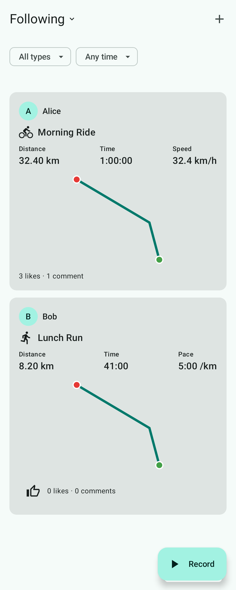
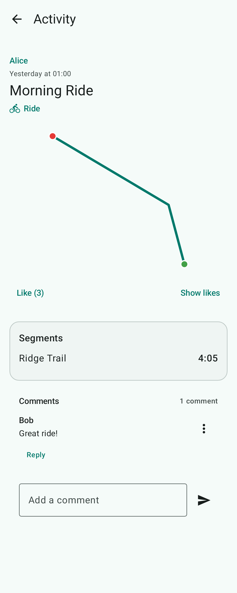
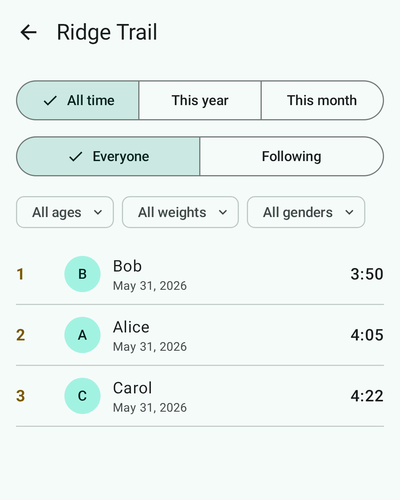
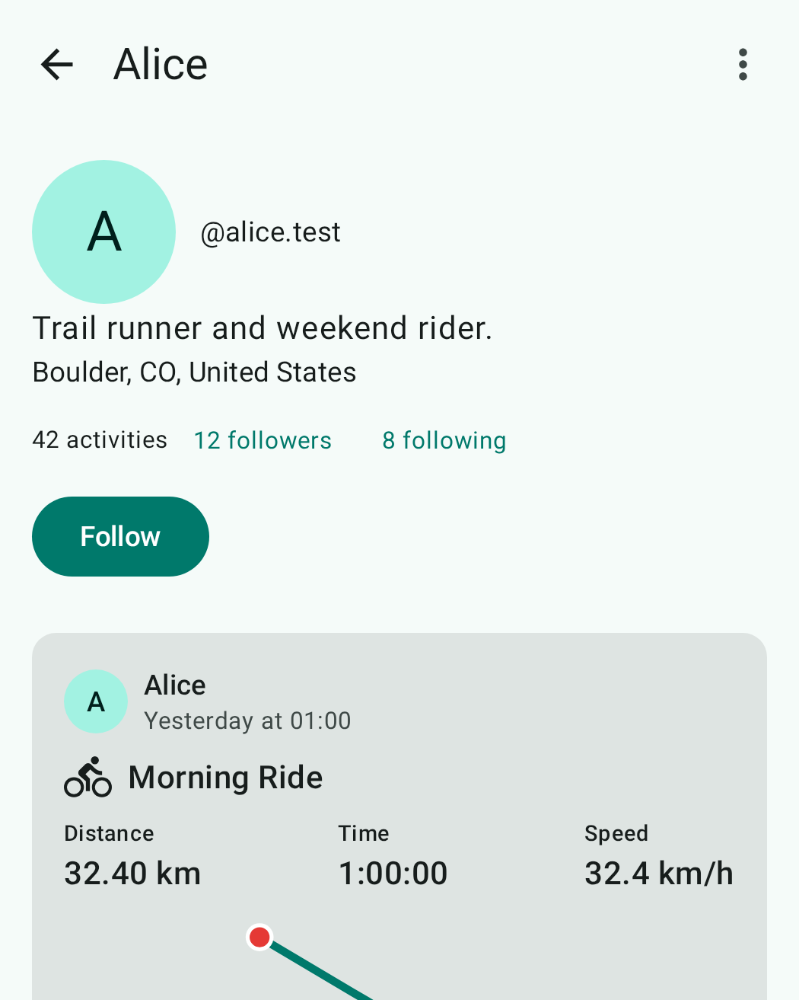
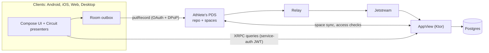

# Activity Tracker

[](https://github.com/solcott/activity-tracker/actions/workflows/ci.yml)

A social activity tracker for athletes, built on the [AT Protocol](https://atproto.com), the open network behind
Bluesky. Athletes own their data: activities, likes, comments, follows, gear and profiles are records in each
athlete's own repository (their PDS), and this project's AppView indexes them from the network and serves feeds,
segments and leaderboards. One Kotlin Multiplatform codebase runs on Android, iOS, the web and desktop.

<p>
  
  
  
  
</p>

<sub>Screenshots are the app's screenshot-test references, rendered from fixture data.</sub>

## Features

- **Record and import.** GPS recording on phones, with pause, auto-recovery and privacy zones. Import and export of
  FIT, GPX and TCX, plus dive logs (Garmin, Shearwater, UDDF, Subsurface) with gases, tanks and depth profiles.
- **Rich activity pages.** Maps (MapLibre), elevation, heart rate, power curve, zones, laps, multisport legs,
  swim lengths and strength sets. Recordings from several devices can be combined into one activity.
- **Segments.** Trail segments imported from OpenStreetMap and public agency data or created by athletes, matched
  against tracks in the background, with leaderboards (age, weight and gender brackets), mayors and
  community-voted names.
- **Privacy per detail.** Each activity is Public, Followers, Mutuals or Only me, and each category of detail (map,
  heart rate, power, start time…) can be narrower. Non-public data lives in ATProto *spaces*, and the AppView
  serves each piece only to the viewers its tier admits.
- **Social.** Follows (with approval), likes, comments with audiences, blocks, mutes, reports and labels.
- **Gear.** Bikes, shoes and components with usage totals, and sensors.

## Architecture



Clients write straight to the athlete's PDS through an offline-first outbox. The AppView never writes to a
repository: it tails Jetstream, indexes records into Postgres and answers `app.activitytracker.*` queries. It also
syncs the athletes' non-public spaces as their managing app, and decides who may read what. The lexicons in
`lexicons/` are the schema source of truth, mirrored by hand in `core/lexicon` and shared by clients and server.

## Tech highlights

- **Kotlin Multiplatform** on four targets with a shared **Compose Multiplatform** UI that follows each platform's
  conventions. **Circuit** handles screens, **Metro** handles compile-time DI, and **Room 3** caches on every target
  (SQLite-WASM in a Web Worker on the web).
- A hand-written **ATProto client** on Ktor: XRPC, identity resolution, OAuth with PAR, PKCE and DPoP, and
  service-auth JWTs. No SDK, so it also runs on Kotlin/Wasm.
- A **Ktor + Postgres AppView**: a Jetstream indexer, a spaces syncer, ES256K/ES256 JWT verification, a background
  segment matcher and Flyway migrations.
- Per-platform **FIT decoders** and GPX, TCX, UDDF and Subsurface readers and writers.
- **Quality gates**: tests on the JVM for every module, Android screenshot tests for every screen, ktfmt, detekt with
  the repo's own rules, Compose stability checks, Gradle convention plugins and a local Docker ATProto network for
  end-to-end runs.

## How it was built

This project was developed with AI coding assistants (Claude Code, Antigravity) under a spec-driven workflow with
[OpenSpec](https://github.com/Fission-AI/OpenSpec). Each feature starts as a change with a proposal, a design, delta
specs and tasks. It is then implemented and verified, and archived into the living specs:

- [`openspec/specs`](openspec/specs): what the system does today, by capability
- [`openspec/changes/archive`](openspec/changes/archive): every change, with its reasoning
- [`AGENTS.md`](AGENTS.md), [`.agents/`](.agents) and [`.claude/`](.claude): the project rules, skills, hooks and
  subagents the assistants work under

## Local development

Requires JDK 25, Docker, Android SDK (for Android), Xcode (for iOS), and `cloudflared` for native sign-in
(`brew install cloudflared`).

The build resolves [kmp-dataresult](https://github.com/solcott/kmp-dataresult) from Maven Central (its
`-SNAPSHOT` versions from the Central snapshot repository). To build against a local checkout instead, name it
in `~/.gradle/gradle.properties` (an absolute path):

```properties
dataresult.dir=/path/to/kmp-dataresult
```

```bash
scripts/dev.sh --seed alice     # Docker stack, tunnel, local.properties, AppView, adb reverse, alice.test
scripts/dev.sh status           # what's running, and whether the tunnel URL, AppView and local.properties agree
scripts/dev.sh down             # stop the AppView, the tunnel and the containers (data is kept)
```

`scripts/dev.sh` is safe to re-run: it checks each piece and only starts, restarts or rewrites what is
missing or stale. When the tunnel URL changes it rewrites `local.properties`, restarts the AppView and
reinstalls the Android debug app on connected devices (`--android` forces the reinstall, `--no-android`
and `--no-tunnel` skip those steps). The AppView and tunnel run in the background with logs in `.dev/`.
The steps below are what it automates.

```bash
cp docker/.env.example docker/.env
docker compose -f docker/compose.yaml up -d      # PLC :2582, PDS :2583, relay :2470, Jetstream :6008, Postgres :5433
docker/scripts/create-account.sh alice          # creates alice.test (password in docker/.env)
./gradlew :server-appview:run                    # AppView on :8081
./gradlew :webApp:wasmJsBrowserDevelopmentRun       # web app on http://127.0.0.1:8080
./gradlew :desktopApp:hotRun --auto                  # desktop app with Compose Hot Reload
```

The first `up` builds PLC, the relay and Jetstream from source, which takes a few minutes. The PDS is
Bluesky's atproto Spaces alpha, pinned by digest. It is amd64-only, so Apple Silicon runs it under Rosetta.
Its schemas change without migrations, so bumping it means wiping the volumes
(`docker compose -f docker/compose.yaml down -v`) and re-seeding. `docker/scripts/spaces-smoke.sh alice`
checks that it serves Spaces. Spaces' managing-app callouts reach the AppView only through the tunnel below. The relay
and Jetstream are pinned and carry one-line patches that let them reach a plain-HTTP `localhost` PDS
(see `docker/relay.Dockerfile` and `docker/jetstream.Dockerfile`). The AppView starts at Jetstream's
live tip on first run, so records written before it first connects are not indexed.

Sign in on the web or desktop app with `alice.test`. Both use the ATProto *loopback* OAuth client,
so they need no hosted client metadata. The desktop app catches the redirect on `127.0.0.1:8091`.

**Native (Android/iOS) sign-in** needs OAuth client metadata the PDS can fetch over HTTPS, so expose
the AppView through a tunnel. The tunnel URL is set once and everything else (client ID, the redirect
scheme `com.trycloudflare.<name>`, the Android manifest, the AppView's `APPVIEW_PUBLIC_URL`) derives from it:

```bash
brew install cloudflared
cloudflared tunnel --url http://localhost:8081   # prints https://<name>.trycloudflare.com
echo "activitytracker.appviewPublicUrl=https://<name>.trycloudflare.com" >> local.properties
./gradlew :server-appview:run                    # restart so it serves the new URL
```

Then rebuild the apps. Quick tunnels get a new hostname each run, so update the property each time
(or pass `-Pactivitytracker.appviewPublicUrl=...`).

With a tunnel set, the AppView's DID is the tunnel host. `:server-appview:run` also sets
`APPVIEW_EXTRA_AUDIENCES=did:web:localhost%3A8081` so the web app keeps working against the same AppView.

`:server-appview:run` also sets `APPVIEW_ALLOW_PRIVATE_ADDRESSES=true` unless the environment sets it. Outside local
dev the AppView refuses to fetch from private, loopback or link-local addresses it learns from DID documents and handles,
and every PDS and `did:web` on the local stack is `localhost`. It logs a warning at startup while the flag is on.

- **Android** (emulator, or a device over USB/wireless adb): run `adb reverse tcp:2582 tcp:2582` (and 2583,
  8081) so the device's `localhost` reaches the stack. Repeat after the emulator/device reconnects.
- **iOS Simulator** shares the Mac's network, so it needs nothing extra.
- **Physical iPhone** is not supported against the local stack: the PDS identifies itself as
  `http://localhost:2583` (in DID docs and as the OAuth issuer), which a phone can't reach, and iOS has
  no `adb reverse`. That needs a config against public services instead.

## Layout

| Path | What |
|---|---|
| `lexicons/` | Lexicon JSON (`app.activitytracker.*`), the schema source of truth |
| `core/lexicon` | Kotlin models + typed XRPC method descriptors, shared by clients and AppView |
| `core/atproto` | XRPC client, identity resolution, OAuth (PAR/PKCE/DPoP), service auth |
| `core/data` | Room 3 cache + outbox, repositories, Metro bindings |
| `core/location` | GPS trackers per platform, recording engine, polyline/GPX |
| `core/activityfile` | FIT, GPX, TCX, UDDF, Subsurface and Shearwater readers and writers, per-platform FIT decoders |
| `feature/<name>/{api,presenter,ui}` | One feature each: its Circuit contracts (`Screen`, `State`, `Event`), presenters (Compose runtime, no UI) and UIs |
| `app/common/{api,presenter,ui}` | What several features share: contracts, presenter helpers, domain widgets |
| `ui/designsystem`, `ui/resources` | Adaptive components, theme and charts; every string and drawable |
| `app/fixtures` | Sample states for every screen, used by UI tests, previews and screenshot tests |
| `composeApp` | The app shell: `App`, navigation, Metro graphs and scopes, platform actuals |
| `androidApp`, `iosApp`, `webApp`, `desktopApp` | Thin platform shells (entry points, graph roots); `androidApp` also holds the screenshot tests |
| `web/sqlite-worker` | SQLite-WASM Web Worker backing Room on the web |
| `server/appview` | Ktor AppView: Jetstream indexer, spaces syncer, XRPC queries, segment matcher, did:web |
| `server/segment-importer` | CLI that turns OSM and agency trails into candidate segments and publishes ridden ones |
| `docker/` | Local ATProto network |
| `build-logic`, `config/` | Gradle convention plugins and the detekt config |
| `detekt-rules` | The repo's own detekt rules, run by every module's detekt |
| `samples/` | Third-party sample files for trying imports by hand |
| `scripts/` | Local environment, segment import and repository checks |
| `openspec/` | Specs and the change history (see [How it was built](#how-it-was-built)) |

## Known gaps

- A recording goes on with the screen off or the app in the background, but if the system kills the app it doesn't restart on its own: the next launch offers it back to resume, save or discard. Restarting by itself would need "Allow all the time" location access, which the app doesn't ask for.
- The recording notification on Android shows distance in the device region's units, not the athlete's chosen ones.
- On the web, route maps are a static canvas preview with no enlarged map. Android, iOS and desktop draw them with MapLibre.

## License

[Apache License 2.0](LICENSE). Third-party sample and test files keep their own licenses, which sit beside them in
[`samples/dive-logs/`](samples/dive-logs) and [`core/activityfile/src/jvmTest/resources/dives/`](core/activityfile/src/jvmTest/resources/dives).
